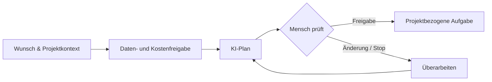

# JOLIBEN

### KI kann viel. Was wir daraus machen, zählt.

**Independent AI & Product Lab · seit 2026**  
**Agentische Systeme · Nachvollziehbare Entwicklung · Menschliche Verantwortung**

[**Website entdecken ↗**](https://joliben.github.io/joliben-website/) &nbsp;·&nbsp; [**Agenten erleben ↗**](https://joliben.github.io/joliben-website/agenten.html) &nbsp;·&nbsp; [**Ausgewählte Arbeiten ↗**](https://joliben.github.io/joliben-website/arbeiten.html) &nbsp;·&nbsp; [**English ↓**](#english)

---

## Worum es geht

JOLIBEN ist ein **unabhängiges, selbst gehostetes KI- und Produktentwicklungsprojekt**. Wir erforschen, wie sich KI-Unterstützung in verlässliche Arbeitsabläufe übersetzen lässt – mit eindeutigen Zuständigkeiten, überprüfbaren Ergebnissen und bewussten menschlichen Entscheidungen.

Hier geht es nicht um die Inszenierung fertiger Autonomie. Wir zeigen **reale Entwicklungsarbeit**, auch ihre Grenzen: Was ist bereits implementiert und geprüft? Was entsteht gerade? Und was gehört noch zur Vision?

> **Unser Grundsatz:** Keine Behauptung ohne passende Einordnung. Konzept, Simulation, Testnachweis und produktive Funktion sind unterschiedliche Dinge.

## Projekte im Überblick

| Projekt | Fokus | Einordnung |
| :--- | :--- | :--- |
| **JOLIBEN** | KI-gestützte Planung, überprüfbare Aufgaben, Freigaben und zunehmend durchgängige Entwicklungsabläufe | **Aktive Entwicklung.** Einzelne Planungs-, Aufgaben- und UI-Abläufe sind implementiert und geprüft; der vollständige Self-Development-Bedienweg ist noch im Aufbau. |
| **KIBORAYA** | Multi-Perspektiven-Bewertung mit spezialisierten Jurorenrollen, Synthese und Evidence | **Konzept / Prototyp.** Noch kein vollständig bereitgestelltes Produkt. |
| **AUREL & MOX** | Unterschiedliche digitale Künstlerperspektiven und kreative Zusammenarbeit zwischen Mensch und KI | **Kreative Exploration.** Kein fertiges Künstler- oder Plattformangebot. |

**Mehr erfahren:** [Projektübersicht](https://joliben.github.io/joliben-website/#projekte) · [Interaktiver Fahrplan](https://joliben.github.io/joliben-website/#fahrplan)

## Vom Wunsch zur bewusst angelegten Aufgabe

Der unten dargestellte **Planungs- und Auftragsweg** ist in begrenztem Umfang real umgesetzt und getestet. Er ist **nicht** mit einem vollständig autonomen Entwicklungs- und Deploymentprozess gleichzusetzen.

Die Erstellung einer Aufgabe **berechtigt nicht automatisch** zu Codeänderungen, KI-Workerstarts, Commits, Deployments oder GitHub-Pushes. Dafür gelten eigene Prüf- und Freigabeschritte.

[**Vier Agenten-Szenarien interaktiv ausprobieren ↗**](https://joliben.github.io/joliben-website/agenten.html)  
*Die öffentliche Erlebnisansicht ist eine Simulation ohne echte KI-Aufrufe oder Verbindung zur privaten JOLIBEN-Runtime.*

## Ausgewählte Entwicklungsnachweise

| Bereich | Was nachgewiesen wurde | Wichtige Grenze |
| :--- | :--- | :--- |
| **Planung & UI** | 344/344 **ausgewählte** Tests bestanden (UI-/Inbox-Release 012, Oktober 2026); Browserfunktion anschließend menschlich bestätigt | Keine Behauptung einer vollständig bestandenen Gesamttestsuite |
| **Self-Build** | Ein **begrenzter, geprüfter** Entwicklungsdurchlauf wurde bis zum Deployment nachgewiesen | Kein Nachweis durchgehend autonomer Entwicklung für beliebige Aufgaben |
| **Private Quellcodesicherung** | 827/827 ausgewählte Core-Dateien in einem privaten GitHub-Stand abgeglichen und durch frischen Clone rückgeprüft | Keine Aussage über ein vollständiges Betriebssystem- oder Laufzeitdatenbackup |

Hinter jedem Ergebnis stehen Entscheidungen, Rückschläge, Korrekturen und eine bewusste Prüfung. Diese Arbeitsweise zeigen wir in den [**ausgewählten Projektfällen**](https://joliben.github.io/joliben-website/arbeiten.html).

## Was als Nächstes kommt

- **Aktuelles Projektwissen:** bessere, revisionsgebundene Planung mit nachvollziehbarer Quellenherkunft (in Arbeit).
- **JOLIBEN entwickelt JOLIBEN:** den Übergang von Planung über kontrollierte Ausführung bis zur Abnahme zunehmend in einer Oberfläche verbinden (geplant / in Teilen bereits technisch erprobt).
- **KIBORAYA:** nachvollziehbare Bewertungen durch verschiedene fachliche Perspektiven weiterentwickeln (geplant).
- **Langfristig:** mehr lokal betriebene Modelle, getrennte Installationen und weitere kreative KI-Experimente (Vision).

[**Zum öffentlichen Masterfahrplan ↗**](https://joliben.github.io/joliben-website/#fahrplan)

## Offen zeigen. Den Core schützen.

Dieses Organisationsprofil und das Repository [**joliben-website**](https://github.com/Joliben/joliben-website) enthalten bewusst freigegebene Präsentationsmaterialien. Der **JOLIBEN-Anwendungscode und interne Entwicklungsunterlagen bleiben privat**. Eine öffentliche Projektpräsentation bedeutet daher keine Open-Source-Freigabe des Cores.

## Wer dahintersteht

**Thiemo Gerhardt** · Initiator & Product Owner  
IT-Hintergrund, unternehmerische Erfahrung und Fokus auf KI-Produktentwicklung, Digitalisierung und verantwortbare Automatisierung.

Meine Aufgabe ist es, Probleme zu strukturieren, Anforderungen und Grenzen zu definieren, KI-gestützte Umsetzung zu steuern und Resultate kritisch zu prüfen. KI-generierten Code gebe ich nicht als persönlich von mir geschriebenen Code aus.

**Kontakt:** [thiemo.gerhardt@icloud.com](mailto:thiemo.gerhardt@icloud.com)  
**Standort:** Ottendorf-Okrilla, Deutschland  
**Rechtliche Angaben:** [Impressum](https://joliben.github.io/joliben-website/impressum.html) · [Datenschutz](https://joliben.github.io/joliben-website/datenschutz.html)

---

## English · What is JOLIBEN?

**AI can do a lot. What we make of it matters.**

JOLIBEN is an **independent, self-hosted AI and product-development project** founded in 2026. Its aim is to make agentic workflows understandable, testable and subject to deliberate human decisions.

This is a record of actual product work — **not a claim of fully autonomous software development**. We explicitly distinguish implemented functionality, verified tests, interactive simulations, prototypes and future ambitions.

| Initiative | Focus | Status |
| :--- | :--- | :--- |
| **JOLIBEN** | AI-supported planning, governed task creation and evidence-based development | Active development; individual workflows have been implemented and verified, full end-to-end experience remains a goal |
| **KIBORAYA** | Multi-perspective evaluation through specialist jurors, synthesis and evidence | Concept / prototype |
| **AUREL & MOX** | Distinct digital artistic voices and human–AI creative exploration | Exploratory concepts |

**Selected evidence:** 344/344 *scoped* UI/inbox checks passed for a documented October 2026 release; a bounded self-build workflow was demonstrated; 827 selected source files were verified following a private GitHub backup and fresh clone. These figures refer to specific checks, **not** a full system certification.

**Human authority remains essential.** Creating a task does not grant permission for code edits, model execution, deployment or publishing changes.

**Explore:** [Website](https://joliben.github.io/joliben-website/) · [Interactive agent experience (simulation)](https://joliben.github.io/joliben-website/agenten.html) · [Selected work](https://joliben.github.io/joliben-website/arbeiten.html) · [Roadmap](https://joliben.github.io/joliben-website/#fahrplan)

**Initiator & Product Owner:** Thiemo Gerhardt · [Get in touch](mailto:thiemo.gerhardt@icloud.com)

---

*Real work. Honest limits. Human decisions.*  
[**JOLIBEN Website ↗**](https://joliben.github.io/joliben-website/)

